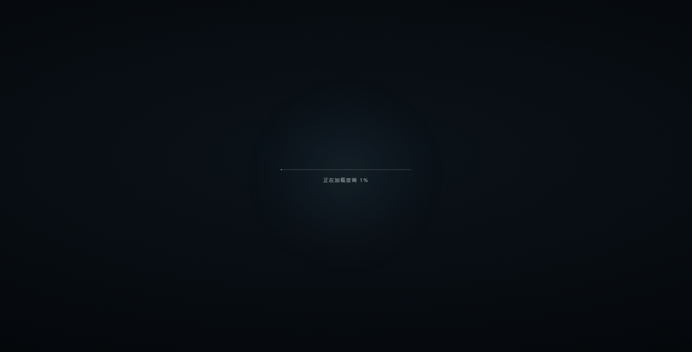

# 可拓展前端视频加音频框架

一个纯音画展示页面框架：只需要 1 个视频和 1 个音频。

它保留进入层、全屏视频背景、音乐渐入、鼠标视差、响应式适配与素材错误提示。**页面没有倒计时，也没有任何展示文字**；点击进入后，画面中只有视频和音乐。

进入层会先显示音画加载进度条。视频和音频没有加载完成时，不会出现「点击进入」，也无法进入；两者都就绪后才会显示进入提示并开放点击。

加载阶段：



加载完成后：


## 快速开始

1. 复制整个「可拓展前端视频加音频框架」文件夹，并按新项目命名。
2. 往 `assets/` 里放入新项目的 **1 个视频** 和 **1 个音频**，文件名随意。
3. 双击 `启动网页.bat`。

启动器会自动扫描素材、更新 `assets/manifest.js`，然后打开 `index.html`。不需要输入文字，也不需要改代码。

> 框架自带示例视频 `bg-video.mp4` 和示例音乐 `bgm.mp3`，它们会**自动让位**给新导入的素材。
> 所以可以直接把新素材放进 `assets/`，不需要先删除示例。
>
> 浏览器出于安全限制，不能直接读取本地文件夹的文件列表，所以需要启动器完成扫描。
> 素材不变时，之后也可以直接双击 `index.html`；**每次增删或替换素材后，请用 `启动网页.bat` 打开一次**。
>
> 页面上仍保留「点击进入」作为进入层提示。这是为了满足浏览器的自动播放限制：用户点击后，视频与音乐才能可靠播放。
> 进入提示只会在视频和音频都加载完成后出现，在此之前显示加载进度条且不可进入。

## 素材规则

- 视频格式：`.mp4`、`.webm`、`.ogv`、`.mov`、`.m4v`
- 音频格式：`.mp3`、`.wav`、`.ogg`、`.oga`、`.m4a`、`.aac`、`.flac`、`.opus`
- 导入的新视频、新音频各保留一个即可；框架自带的 `bg-video.mp4` / `bgm.mp3` 不计入这个数量。
- 除示例素材外，同类文件多于一个时，启动器会列出候选并提示你只保留一个，避免选错。
- 文件名可以是中文、空格或混合大小写，不需要改名。
- 背景视频会自动静音、循环并铺满屏幕；音乐在点击进入后从 0 渐入到配置音量。

## 自定义

| 想改什么 | 去哪里改 |
| --- | --- |
| 进入提示 | `config.js` 中的 `enterText` |
| 音乐目标音量、渐入时长、渐入延迟 | `config.js` 中的 `targetVolume`、`fadeDuration`、`fadeDelay` |
| 主色、字体 | `styles.css` 顶部的 `:root` 变量 |
| 视频压暗、饱和度、对比度 | `styles.css` 中 `.bg-video` 的 `filter` |
| 视频 / 音频 | 替换 `assets/` 中的文件，再启动一次 |
| 素材扫描逻辑 | `tools/scan-assets.ps1` |

## 文件结构

```text
可拓展前端视频加音频框架/
├─ index.html               页面结构（只有背景视频、音频和进入层）
├─ config.js                配置：进入提示、音量、错误文案
├─ styles.css               视觉与响应式样式
├─ app.js                   进入层、音画同步、视差
├─ 启动网页.bat             一键扫描素材并打开页面
├─ tools/
│  └─ scan-assets.ps1      扫描 assets，生成素材清单
├─ assets/
│  ├─ bg-video.mp4          示例背景视频
│  ├─ bgm.mp3               示例背景音乐
│  └─ manifest.js           自动生成的素材清单（无需手改）
├─ preview.png              加载完成后的效果预览
├─ preview-loading.png      加载进度条预览
└─ README.md
```

## 工作方式

1. `启动网页.bat` 调用 `tools/scan-assets.ps1`。
2. 扫描器确认素材并写入 `assets/manifest.js`：
   ```js
   window.FRAME_ASSETS = {
     video: "assets/你的视频.mp4",
     audio: "assets/你的音乐.mp3"
   };
   ```
3. `index.html` 依次加载 `config.js`、`assets/manifest.js`、`app.js`；`app.js` 把素材写入 `<video>` / `<audio>`。
4. 点击进入层后，视频开始静音循环，音乐从 0 渐入；页面不再叠加任何文字内容。

## 常见问题

**进入后只有视频，没有任何文字**

这是当前版本的预期效果。文字功能已移除；如果以后需要叠加标题或 Logo，可自行在 `index.html` 中加入元素和样式。

**打开后一直停留在加载进度条**

请确认视频和音频文件均可由当前浏览器解码，且文件没有被其他程序占用。加载完成后进度条会自动消失并显示「点击进入」。如果文件较大，首次打开需要等待浏览器完成预加载。

**打开后提示「素材未就绪」**

运行过 `启动网页.bat` 了吗？如果刚刚替换了素材，请重新运行一次。也请检查 `assets/` 中是否至少各有一个受支持格式的文件；如果除示例外有多个同类文件，请只保留需要的那一个。

**点击进入后没有声音**

- 浏览器可能拦截了自动播放，点击进入层后通常即可播放。
- 检查系统音量、浏览器标签页是否静音，以及 `config.js` 的 `targetVolume` 是否大于 0。
- 背景视频本身始终静音，声音只来自音频文件。

**可以直接部署到静态服务器吗？**

可以。把整个文件夹上传到静态站点即可；服务器环境下 `assets/manifest.js` 同样能被读取。素材变化后重新运行扫描器并上传新的 `manifest.js`。
